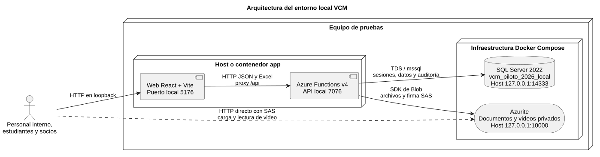
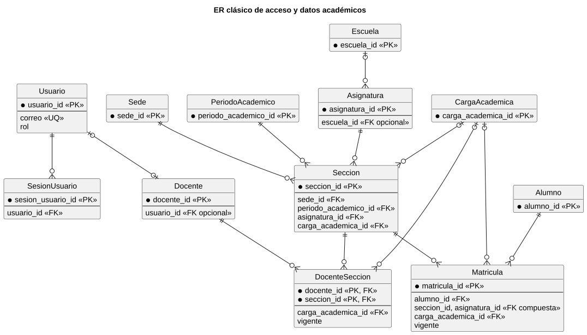
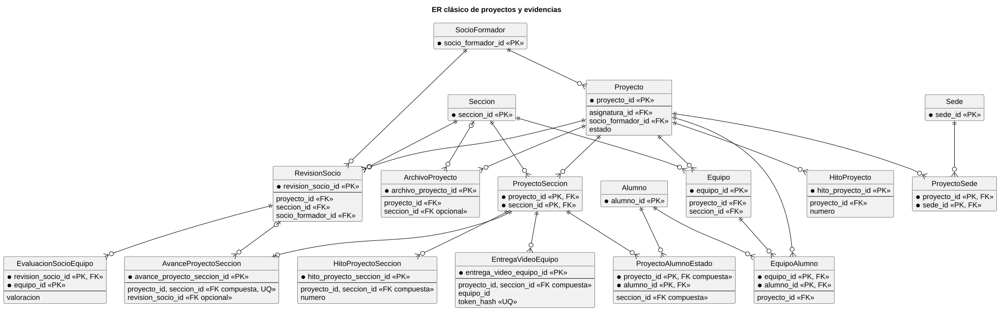
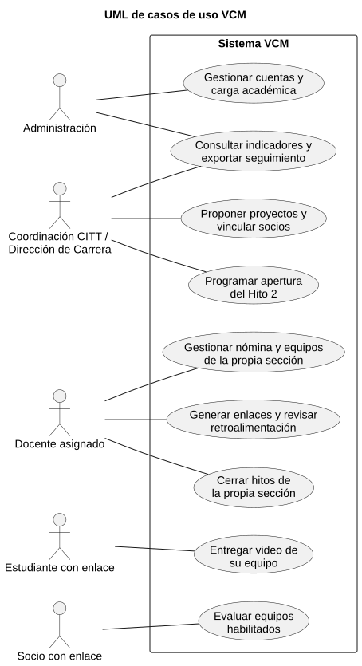
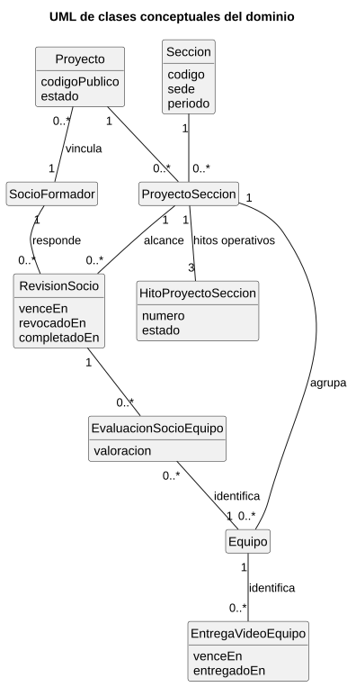
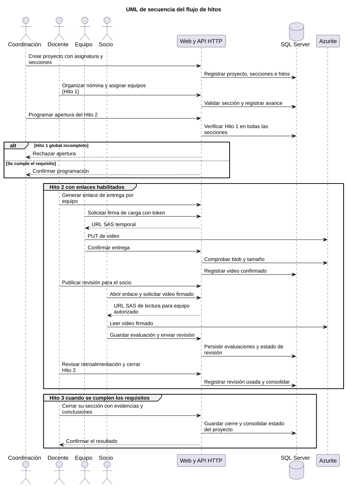
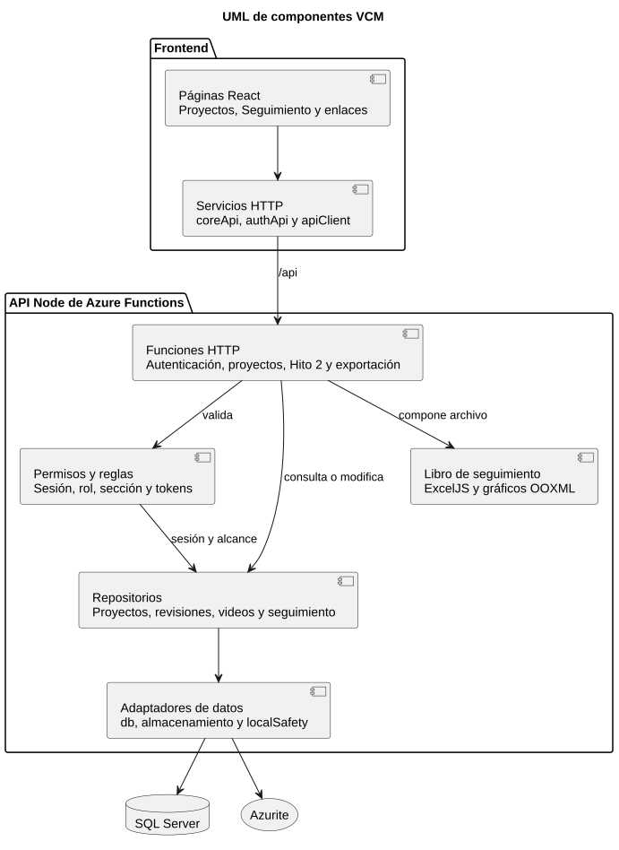

# Cierre técnico del Sistema Gestor de Proyectos VCM

15 de noviembre de 2026. Entrega para APT122. El alcance de esta revisión es VCM Piloto 2026 Local, con base, archivos y cuentas de pruebas.

## Cobertura de la pauta

| Punto | Antes de esta revisión | Evidencia incorporada |
| --- | --- | --- |
| 1. Arquitectura | Tecnologías y capas descritas en el contexto del proyecto. | Vista de arquitectura, componentes y protocolos entre servicios. |
| 2. Modelo de datos | 18 migraciones SQL y un ER académico de octubre hasta la migración 014. | ER actualizado para el entorno local, con entregas de video, revisiones y consolidación por sección. |
| 3. UML | Flujos y roles descritos en texto e historias de usuario. | Casos de uso, clases conceptuales, secuencia de hitos y componentes UML. |
| 4. Requisitos no funcionales | Controles de seguridad y arranque documentados en distintas fuentes. | Criterios de seguridad, rendimiento, escalabilidad, disponibilidad y portabilidad, con evidencia y alcance. |
| 5. Docker | Compose para SQL Server y Azurite, variables de ejemplo e instrucciones para ejecutar web y API en el host. | Dockerfile para web y API, archivo Compose adicional y procedimiento de instalación y arranque en Docker. |
| 6. Pruebas | Suite unitaria, integración con API/SQL, controles de acceso y pruebas de aislamiento. | Medición reproducible de rendimiento y registro de las verificaciones para la entrega. |
| 7. Innovación | Relevancia y aportes descritos en el informe. | Respuestas explícitas sobre problema, diferenciación y valor en el informe final y en este documento. |

## 1. Arquitectura

La web React se entrega con Vite. La interfaz llama a sus servicios en `src/services`, que usan las rutas HTTP de Azure Functions v4 bajo `/api`. Las funciones validan sesión, permisos por rol o sección y alcance de los enlaces. Los repositorios usan consultas parametrizadas y transacciones SQL donde corresponde. Seguimiento transforma los resultados en indicadores y genera Excel mediante ExcelJS y gráficos nativos OOXML.

| Comunicación | Protocolo | Responsabilidad |
| --- | --- | --- |
| Navegador → Vite → Functions | HTTP local, JSON, multipart y XLSX | Vite sirve la interfaz y pasa `/api` a `127.0.0.1:7076`. Para personal interno, el navegador envía la cookie de sesión del mismo origen. |
| Functions → SQL Server | TDS mediante `mssql` | Sesiones, matrícula, proyectos, estados por sección, revisiones y auditoría. La aplicación usa `127.0.0.1:14333` y verifica el nombre de la base. |
| Functions → Azurite | SDK Azure Storage Blob | Gestiona documentos privados, verifica la existencia y tamaño de videos y emite firmas temporales. |
| Navegador ↔ Azurite | HTTP local con URL SAS | El equipo sube el video y el socio autorizado lo reproduce. La URL usa el puerto local 10000 y se emite para un blob específico. |

En Docker, web y API comparten el contenedor `app`. Los relés de loopback de ese contenedor se conectan a los servicios fijos `sql` y `storage` de Compose. El navegador sigue accediendo por los puertos originales del equipo.

## 2. Modelo de datos

Modelo entidad-relación clásico de SQL Server, con claves y cardinalidades en pata de gallo. Los diagramas muestran las relaciones centrales. El detalle de columnas, constraints, índices, entidades administrativas y registros históricos está en las [migraciones SQL](../database/migrations/).

- `ProyectoSeccion` y `ProyectoSede` resuelven asociaciones entre proyectos, secciones y sedes. La matrícula pertenece a una sección y asignatura. `DocenteSeccion.vigente` participa en la autorización de esa sección.
- Los hitos de sección son únicos por proyecto, sección y número. El avance de cierre de una sección puede referenciar la revisión del socio utilizada. La aplicación consolida los hitos globales a partir de las secciones responsables.
- Las entregas y evaluaciones guardan un identificador de equipo para mantener su historial al reorganizar la nómina. Esas dos referencias al equipo son lógicas. Sus claves foráneas físicas se muestran en el ER.
- SQL conserva metadatos y referencias de archivo. Azurite conserva los bytes. `Auditoria`, `NotificacionVista`, `CargaSocioFormador` y `Migracion` cubren control, importación y evolución del esquema.

## 3. Diagramas UML

Los archivos fuente editables `.puml` acompañan a las imágenes en [docs/diagramas](diagramas/). El diagrama de clases representa el dominio del sistema. El código implementa las operaciones con funciones, objetos y repositorios JavaScript.

### Casos de uso

Dirección de Carrera usa el rol `coordinator`, con un cargo visible propio. El acceso docente se aplica a las secciones asignadas. Los enlaces de estudiante y socio se validan según su propósito y alcance.

### Clases conceptuales

### Secuencia principal de hitos

### Componentes

## 4. Requisitos no funcionales

| Área | Criterio de aceptación para el entorno local | Evidencia y alcance |
| --- | --- | --- |
| Seguridad | Rechazar peticiones sin sesión y accesos de roles o secciones ajenos. Validar tokens temporales y mantener los archivos en contenedores privados. Limitar servicios y destinos a la copia de pruebas. | Cookie HttpOnly y SameSite Strict, hashes scrypt, permisos en API, auditoría, pruebas de aislamiento e integración. HTTP está reservado a loopback para esta instalación. |
| Rendimiento | p95 de hasta 750 ms en salud, 2.500 ms en Seguimiento y 6.000 ms en Excel de finalizados, con las concurrencias de la prueba local y cero errores HTTP o de contenido. | `npm run test:performance -- --docker` mide el tiempo hasta descargar la respuesta completa. Los umbrales son criterios de esta entrega. |
| Escalabilidad | Poder agregar sedes y proyectos mediante datos y mantener disponibles filtros, consulta y exportación dentro de los presupuestos de la prueba local. | DEMO26/DUOC26 representan varias sedes y proyectos. Los índices de SQL y el envío de video directo a Azurite reducen trabajo de la API. Las mediciones corresponden a una sola instancia y a la carga descrita. |
| Disponibilidad | Identificar si SQL está accesible mediante `/api/health`. Al reiniciar el servicio de aplicación, recuperar la atención de solicitudes y mantener base y archivos en volúmenes Docker. | Compose comprueba salud cada 10 segundos y el endpoint informa 503 cuando falla SQL. La instalación local tiene una instancia de cada servicio. |
| Portabilidad | Construir con lockfiles, preparar el esquema con 18 migraciones e iniciar la aplicación y su infraestructura en Docker Compose. | Node 22, Functions Core Tools v4, SQL Server 2022 y Azurite. El arranque comprobado está en el README. |

## 5. Docker

El [Dockerfile](../Dockerfile) compila la web y prepara el runtime local de Functions. [compose.yaml](../compose.yaml) define SQL y Azurite con volúmenes. [compose.app.yaml](../compose.app.yaml) agrega la web y la API, más la comprobación de salud. El [README](../README.md#arranque-completo-con-docker) contiene el procedimiento.

La [plantilla de entorno](../.env.example) documenta `VCM_LOCAL_SQL_PASSWORD`. `npm run local:configure` genera el valor y prepara los ajustes para el modo en host a partir de [la plantilla de Functions](../api/local.settings.example.json). Compose pasa la configuración de SQL en tiempo de ejecución. El contexto de construcción excluye los archivos de configuración privada, datos y exportaciones.

Referencias de implementación. [Redes de Docker Compose](https://docs.docker.com/compose/how-tos/networking/) y [Azure Functions Core Tools](https://learn.microsoft.com/es-es/azure/azure-functions/functions-run-local).

## 6. Pruebas

| Tipo | Ejecución | Qué comprueba |
| --- | --- | --- |
| Unitarias y de interfaz | `npm run local:verify` | Estado de hitos, inscripciones, equipos, evaluaciones, consolidación, filtros y generación de libros. Incluye lint y compilación. |
| Integración | `npm run test:integration` con la API en 7076 | Permisos HTTP, respuestas de indicadores y cálculo sobre fixtures en SQL real. La suite prepara y limpia sus propios registros. |
| Rendimiento | `npm run test:performance -- --docker` | Salud, Seguimiento y exportación filtrada. Una petición previa de calentamiento por ruta, 56 muestras medidas y percentil 95 por rango más próximo. |
| Seguridad | `npm run test:isolation` y la suite de integración | Destino exclusivo local de SQL y blobs, restricciones por rol, sesión y rechazo de parámetros inválidos. Las suites de API incluyen permisos de sección y alcance de tokens y videos. |

Se registran los resultados observados y los datos de alcance en [VERIFICACION.md](../VERIFICACION.md).

## 7. Innovación

**¿Qué problema resuelve?** Centraliza la coordinación de iniciativas de Vinculación con el Medio. Vincula proyectos, secciones, matrícula, equipos, evidencias y evaluaciones. Así, cada responsable puede ver qué etapa está pendiente y quién puede actuar.

**¿Qué hace diferente a la solución?** Coordina el avance de cada sección con el estado global del proyecto. En el Hito 2, el equipo puede entregar su video con un enlace temporal y el socio puede evaluar los equipos habilitados mediante otro enlace. El docente revisa esa retroalimentación para cerrar el hito. Seguimiento usa una misma selección para consultar indicadores y exportar las cifras y gráficos por sede.

**¿Qué valor agrega?** Facilita detectar atrasos y brechas de participación, conserva trazabilidad de videos y evaluaciones y entrega una vista común a quienes coordinan el piloto. El beneficio observado en la demostración es la posibilidad de consultar esas cifras y reproducirlas en Excel. El impacto en tiempos de coordinación y trabajo manual queda sujeto a medición durante el piloto.
